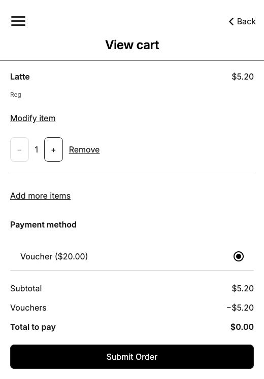
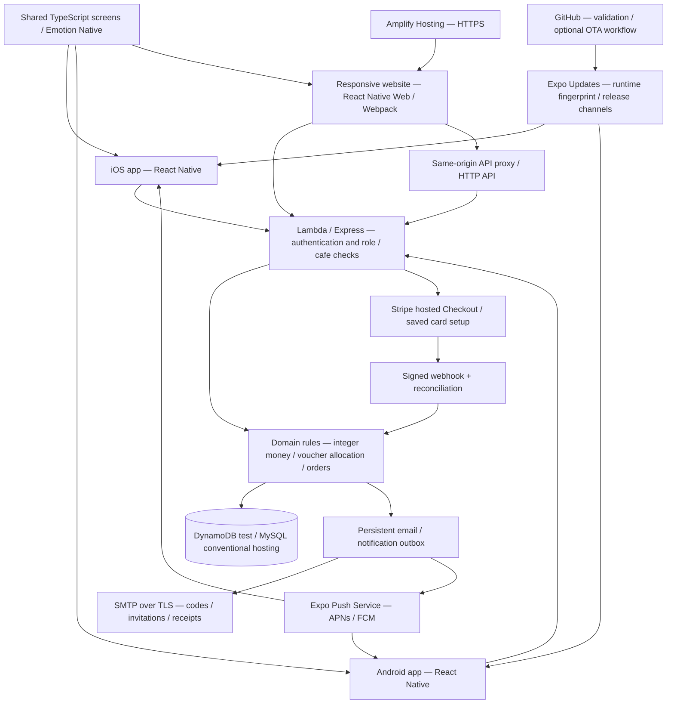

# NEP Cafe Vouchers

React Native + TypeScript application for cafe ordering, corporate vouchers, and cafe management. The same Emotion Native components run on iOS, Android, and the Webpack website through React Native Web. An Express API uses MySQL for conventional hosting and DynamoDB on demand for the low-cost AWS test deployment.

Online test: [Open Cafe](https://test.d2kzvdmp17kwpy.amplifyapp.com).

The AWS test uses Amplify Hosting, a Lambda API, and DynamoDB. SMTP configuration is stored in AWS Systems Manager Parameter Store as a SecureString. The active DynamoDB table is `nep-cafe-test-data`; the original table is retained as an inactive rollback copy. Stripe payments, mobile signing, OTA delivery, and push delivery require their service credentials. See [AWS test deployment](docs/AWS-TEST.md) for deployment, costs, and cleanup.

## Run locally

Use Node.js 24 or newer.

```sh
npm ci
cp .env.example .env
# Configure an existing local MySQL 8.4 database and user in .env.
# Set DEV_DEMO=1 for local demo accounts.
npm run dev
```

Open <http://localhost:8080>. The API listens on port 4000.

For quick local testing, click **Testing mode** and choose Customer or Cafe owner. To use a designated account, enter `marco.arevalo3426@gmail.com` or `marevalo@nepgroup.com` and click **Testing mode** to open Cafe Owner / Customer / Admin selection without an email code. The same button is available after sign-in. Local shortcuts require `DEV_DEMO=1`, a non-production API, and a direct loopback connection; their sessions cannot be used on public hosts. Email delivery is simulated locally.

| Demo role | Email |
| --- | --- |
| Cafe owner | owner@cafe.test |
| Customer | customer@cafe.test |
| Administrator | Enter either allowlisted email and click Testing mode, then choose Admin |

Use any new email to exercise registration and Customer/Cafe Owner selection. Administrator access remains restricted to the two designated emails. New owners receive their own empty cafe; the Gordon demo data belongs only to the demo owner.

During the test phase, `marco.arevalo3426@gmail.com` and `marevalo@nepgroup.com` can sign in without an email code. Other accounts still verify their email. The bypass requires both `APP_STAGE=test` and `TEST_EMAIL_SIGN_IN=allowlisted`; the default is disabled. Set the private deployment setting to `disabled` and redeploy to restore verification; bypass-created sessions then stop working. After either allowlisted account signs in, the app shows **Choose account** with **Cafe Owner**, **Customer**, and **Admin**. The navigation offers **Switch account** for those authenticated emails. Each session keeps its own active role; owner/customer mode has no admin permissions. Owner mode creates one cafe if needed and preserves it across switches. New sign-ins ask again, and existing sessions from earlier versions show the chooser. Other emails keep the ordinary signup choices and cannot select Admin, including through Testing mode or a forged API request.

Local persistence requires the MySQL settings in `.env`; database connections and transactions use `mysql2`. Unit tests use an isolated SQLite test double by default. The integration modes run the same suite against isolated MySQL databases or a disposable DynamoDB table; they never use application data. Legacy SQLite data can be migrated with `npm run migrate:sqlite -- --source data/cafe.sqlite --dry-run`, then without `--dry-run` into an empty MySQL destination. Demo data requires explicit `--allow-demo`. The source remains read-only.

## Preview



## Architecture



The API owns prices, order totals, voucher balances, role checks, cafe ownership, and voucher ownership. Client values are never used as authoritative prices. MySQL InnoDB transactions and unique indexes protect issuance and balances. The DynamoDB test adapter preserves these domain boundaries with conditional revision checks, atomic transactions, and uniqueness checks. Ordered collections are split into 300 KB binary chunks. It retries conflicting commits and supports nested rollback; it is intended for small test datasets. Checkout IDs and idempotency keys prevent repeat fulfillment.

Money is stored in integer cents. Voucher month/year validity ends at the start of the next month in UTC, and the displayed validity shows the selected month. Checkout reserves vouchers while a card payment is pending, applies the earliest-expiring vouchers first, and deducts balances only on confirmed completion. Cancelled/expired payment sessions release their reservations. Reserved vouchers remain available to fulfillment even if a timely payment's webhook arrives after voucher expiry. An independent provider reconciliation pass handles missed webhooks.

## Implemented flows

- Email signup/sign-in, exact invalid-email/code messages, six code fields, cryptographically random six-digit codes, three-minute expiry, resend cooldown, five verification attempts, and persistent 30-day sessions. Web uses an HttpOnly SameSite cookie; native uses SecureStore. Logout revokes every session and registered push token for that user.
- Customer and cafe owner accounts, with administrator access restricted to the two designated emails. Guest cafe browsing and protected cart/account pages.
- Owner orders, newest first; tapping an order completes it; the fixed history footer remains visible. Owner history displays today's completed orders. Customers see their own order history and status.
- Seven menu template categories, category/subcategory deletion confirmations, editable item groups, up to 30 variations per item group, reusable item templates, and customer menus generated from owner data.
- Item variations, quantities and notes, cart modifications, server-calculated checkout, combined voucher balances, split voucher/card payments, order receipts, and a payment-success screen. The cart defaults to Voucher when usable credit is positive and Card / Apple Pay / Google Pay at zero. A single radio selection can be changed manually; voucher shortfalls continue through secure card/wallet checkout. Any enabled signed-in account can place an order without changing its active account selection.
- Voucher generation from 1 to 100 vouchers per request, minimum $10 face value, month/year validity, explicit cash-received confirmation for owners, Card / Apple Pay / Google Pay selected by default, and unique lowercase alphanumeric codes. Issued vouchers belong directly to the generating account and receive a personal receipt. Existing voucher credit can fund issuance; any shortfall uses card checkout.
- Voucher sorting, code display, bulk selection/deletion, and sharing to any valid email. Verifying a valid code assigns it to the signed-in user and refreshes their wallet. Expired, empty, wrong-cafe and reserved codes cannot be claimed; pending-payment credit cannot be shared or deleted.
- Store name/address/logo/currency/contact details, personal profiles, verified email changes, feedback ratings/subjects/messages, and notification preferences.
- Management restricted to the two allowlisted administrator emails (verification is required outside the explicitly enabled test bypass): cafe CSV/JSON import, account CRUD and mobile-number fields, role assignment, subscription status/price management, feedback, announcements, error logs, and exportable configurations for separate branded app builds.
- Native button/page/modal transitions, progress indicators, a slide-in drawer, reduced-motion support for page/drawer transitions, and responsive desktop navigation. Native image/document pickers are included.

Subscription status is manually managed; this version does not charge recurring subscriptions. The configured Stripe account is a single merchant account. Independent cafe payout/settlement across unrelated businesses requires a Stripe Connect design before a multi-merchant production launch.

## Figma implementation

Source: [Cafe](https://www.figma.com/design/m34HLg8fbyFDxu7uYw0jQQ/Cafe?node-id=0-1).

The implementation uses the Figma grey/white palette, Inter font, 24px centered headings, black rounded buttons, 120px mobile headers, 20px content insets, order cards, black category headers, form controls, and dark drawer. Returned assets are downloaded into `public/design`; fonts and their license are in `public/fonts`. There are no temporary Figma asset URLs at runtime.

Principal inspected frames: registration `1:618`, verification `1:638`, role selection `155:228`, orders `16:350`, history `16:371`, vouchers `16:396`, generation `16:487`, organisation steps `16:522` / `16:503`, checkout `16:566` / `16:537`, menu templates `29:678`, builder `54:359`, menu updates `47:1426` / `47:1332`, profiles `78:514` / `91:806`, feedback `104:231`, and My Cafe `168:490`.

The written requirements take precedence where they differ: codes last three minutes rather than the Figma example's 30 seconds; organisation signup, settings, missing form fields, and management functions are included. The two referenced JPG files were not supplied, and no full customer checkout/organisation/admin designs exist in the supplied pages; those screens use the same UI conventions. No matching native Code Connect implementation was available in the initially empty repository.

Card entry intentionally opens the provider's hosted form, where card number/expiry/CVC validation and authentication occur. Modify card saves a replacement through that form; the old card can then be deleted. No raw PAN or CVC is stored or returned by this app. Eligible Apple Pay/Google Pay wallets and saved cards are offered by Checkout on compatible devices after merchant configuration. A saved card is selected at secure checkout.

Café food/drink and vouchers redeemable for physical cafe goods use external payment methods. Apple requires methods other than in-app purchase for physical goods; StoreKit/Google Play Billing were therefore not added for these purchases. See [Apple 3.1.3(e)](https://developer.apple.com/app-store/review/guidelines/) and [Google's payments guidance](https://support.google.com/googleplay/android-developer/answer/10281818?hl=en). See also [Stripe saved methods](https://docs.stripe.com/payments/existing-customers?platform=web&ui=stripe-hosted).

## Configure email and payments

Copy `.env.example` to `.env` and fill in server settings. `npm run api` / `npm start` load it automatically. Never commit it.

1. Set `EMAIL_TRANSPORT=smtp`, `SMTP_HOST`, `SMTP_PORT` (465 or 587), `SMTP_USER`, `SMTP_PASSWORD`, and `EMAIL_FROM`. TLS certificate verification stays enabled. `SMTP_FORCE_IPV4=1` selects IPv4 while preserving the mail hostname for certificate checks. Resend remains optional via `EMAIL_TRANSPORT=resend`.
2. Set Stripe test keys first. Configure a webhook to `https://YOUR_DOMAIN/api/stripe/webhook`, and set `STRIPE_WEBHOOK_SECRET`.
3. Subscribe to `checkout.session.completed`, `checkout.session.async_payment_succeeded`, `checkout.session.async_payment_failed`, and `checkout.session.expired`.
4. Configure Stripe payment methods, eligible wallets, merchant branding, and any required domain registration. Test with Stripe test-mode cards before enabling live keys.
5. Set `APP_ORIGIN` to the exact website origin. Production requires HTTPS and real email configuration. Wallet availability depends on device, browser, customer region, and Stripe settings.

Verification emails use the subject **Verify your email address**, a styled HTML layout with a prominent six-digit code, a three-minute expiry reminder, and a plain-text fallback.

The outbox retries transient delivery failures with backoff and exposes failures in administrator logs. On AWS, a serial worker receives immediate dispatches after successful mutations and a one-minute scheduled retry. Expo push tickets are checked for receipts; unregistered device tokens are removed. Delivery is subject to provider/device behavior, including users disabling OS notifications or force-stopping an Android app.

## Native builds, notifications, and OTA

```sh
# Set EXPO_PUBLIC_API_URL to an API URL reachable from the device.
# localhost on a phone means the phone, not the development computer.
npm run native

# Configure your own Expo project and set EXPO_PUBLIC_EAS_PROJECT_ID.
npx eas login
npx eas build:configure
npx eas build --profile development --platform all
npx eas build --profile preview --platform all
npx eas build --profile production --platform all
```

Use unique `IOS_BUNDLE_ID` / `ANDROID_PACKAGE` values and your Apple/Google developer accounts. Configure APNs and FCM credentials using EAS; Android may also require `GOOGLE_SERVICES_FILE`. Install a development or release build on a physical device. Expo Go does not support the required remote push flow.

In Settings, save order/announcement preferences and tap **Enable device notifications** to request OS permission and register that device. New-order alerts target the cafe owner; completed-order alerts target the customer. The server checks the relevant preference before sending. Push can display while the native app is closed when OS/provider conditions permit. Web push is not implemented; the website directs users to the native app for closed-app alerts.

OTA uses `expo-updates`, runtime fingerprinting, and preview/production channels. Set your EAS project ID before building; updates are disabled when no project ID is configured. Publish only compatible JavaScript/assets:

```sh
npm run update:preview -- --message "Describe the change"
npm run update:production -- --message "Describe the change"
```

Native dependency/permission changes require a new binary. The optional manual GitHub OTA workflow needs `EXPO_TOKEN` as an environment secret and the public build settings as environment variables. Configure GitHub environment reviewers for production releases. No Expo project or app-store account has been created by this implementation.

References: [Expo Updates](https://docs.expo.dev/versions/latest/sdk/updates/), [Expo Notifications](https://docs.expo.dev/versions/latest/sdk/notifications/).

## Server hosting

The requested online test uses AWS Amplify; follow [AWS test deployment](docs/AWS-TEST.md). FTP deployment was cancelled and no FTP upload was performed.

For conventional MySQL hosting:

A Docker image and Caddy HTTPS proxy are provided. Configure DNS and a server with Docker, then set `.env` with `DOMAIN=cafe.example.com`, `APP_ORIGIN=https://cafe.example.com`, `TRUST_PROXY=1`, and the email/payment settings. Keep `DEV_DEMO=0`.

```sh
docker compose up --build -d
```

The app serves the compiled web UI, API, local design assets, and fonts. Caddy terminates HTTPS. MySQL uses a persistent named volume; use MySQL backup/restore tooling. A Node.js runtime is required for this backend. PHP-only hosting cannot execute it. `npm run prepare:hosting` prepares a Node hosting bundle without secrets. Use `APP_BASE_PATH=/cafe` only for subfolder hosting; the Amplify test runs at the domain root.

Free cafes retain orders for six months; paid cafes retain them for 24 months. The cleanup runs at startup and hourly. This is a technical retention policy, not an accounting/archive system. Error logs and outbox entries are retained for up to 30 days; payment reconciliation records remain for idempotency.

App build configurations exported by management provide a name, API URL and cafe ID. Supply unique bundle/package identifiers and a separate Expo project for each independent app before building/signing it. Configuration generation does not deploy or duplicate signing credentials.

## Verification

```sh
npm run check
npm run build:aws
# Optional real database integration; use disposable test infrastructure only:
# npm run test:mysql
# AWS_PROFILE=default npm run test:dynamodb
npx expo install --check
npx expo export --platform ios --platform android --output-dir native-export
```

The suite covers OTP expiry/attempts, session revocation, role boundaries, cafe isolation, voucher uniqueness and limits, split deductions, duplicate requests, reservation cancellation/expiry, sharing membership, recipient unlinking, authoritative pricing, bulk rollback, retention, notification opt-out, email changes, HTTP cookies/access control, and CSV parsing.

See [validation notes](docs/VALIDATION.md) for executed checks and remaining device/provider verification. Native JavaScript export verifies bundling; it does not replace an installed iOS/Android device test or signed binary build.

## Direct voucher accounts upgrade

Startup runs an idempotent compatibility migration: former Organisation users become Customers, voucher links become direct email assignments, and pending paid checkout details remain usable. Original records are archived in `legacy_archive` before retired entities and fields are removed. Existing voucher balances, validity and reservations are preserved. See `docs/AWS-TEST.md` for deployment and database replacement instructions.
